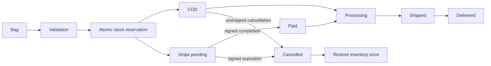

# Architecture

Next.js App Router renders the storefront and workspace. Client screens use Material UI controls, Tailwind/CSS and a browser-local cart. The cart is never authoritative for prices, stock or permissions. Express REST and GraphQL call the same `ShopService`, which validates inputs, enforces authorization and handles checkout/fulfillment.

## Identity

An eight-hour JWT in an HTTP-only cookie carries only the admin account ID. The database supplies current role/active status on every request. Guests need no account. Checkout uses a browser UUID idempotency key, stored as a hash alongside a canonical request hash. Retries return the same order; changed payloads using the same key conflict.

Tracking uses a private HMAC-derived token. Only its hash is persisted. The link places the key in a URL fragment, keeping it out of ordinary URL access logs; REST tracking sends it in a POST body. Anyone holding the key can view delivery details. Rotating the JWT secret revokes admin sessions and changes tokens generated by future checkout retries; previously issued tracking tokens still match their stored hashes.

## Persistence

The typed `Store` abstraction exposes collection access and transactions. Memory transactions serialize writes and commit private snapshots only on success. MongoDB uses sessions and multi-document transactions, requiring a replica set. Unique indexes cover IDs, emails, slugs and checkout hashes. Domain validation runs through Zod in the service; flexible Mongo schemas preserve typed records. Direct database writes bypass business validation.

The adapter currently loads collections before filtering and aggregation. For larger catalogs, implement indexed database filtering, pagination and scoped aggregations. Add retention policies and load tests before scaling. Exhausted Mongo transaction conflicts may require clients to retry with the same checkout key.

## Orders

Each line snapshots product name, image, price, owner and fulfillment. Reassignment affects future orders only. Sub Admins see their own lines and merchandise totals, plus delivery details required for fulfillment. A mixed order reports the earliest stage among non-cancelled lines.

Revenue counts delivered merchandise, excluding shipping. Original purchase totals remain immutable. `currentTotal` excludes cancelled items and retains the original delivery fee while any active item remains; all-cancelled orders have a current total of zero. Screens display this adjusted total. A full refund/payment adjustment ledger remains future work.

## Payment reliability

Stripe session creation happens outside the database transaction using a stable provider idempotency key. A creation failure leaves a pending reservation for safe retry. Only card payment is enabled. Webhooks use the raw body for signature verification; completion checks session association, amount, currency and paid state. Repeated or out-of-order events cannot double-restock or cancel paid orders.

There is no background payment reconciliation worker. Operators must monitor/replay failed webhooks and reconcile uncertain session-creation failures. Paid cancellations are blocked because refunds are not automated. See deployment documentation before live use.
